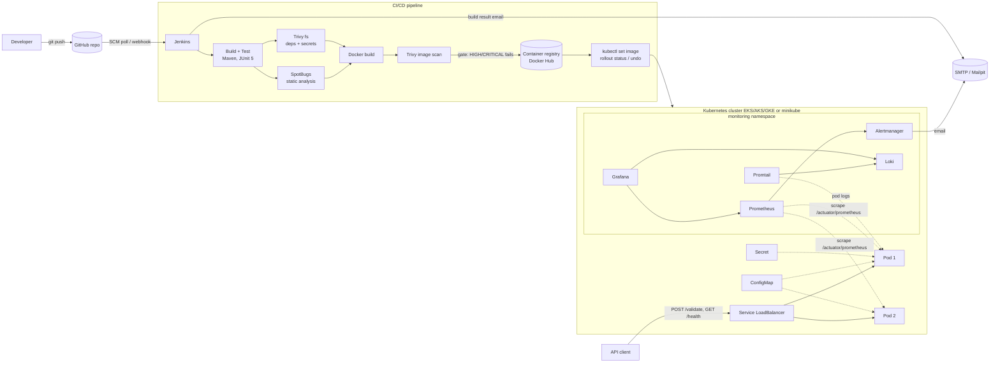

# FinSecure Pay – Design Document

Author: badri35 | Repository: https://github.com/badri35/capstone

## 1. Purpose and scope

FinSecure Pay needs a fast, repeatable and reliable way to deploy a **transaction validation API** with minimal manual
intervention. This document describes the delivery pipeline, runtime platform, security controls, observability and
recovery design, and one proposed AI capability for operations.

## 2. End-to-end architecture

Full-size diagram: [architecture-diagram.pdf](architecture-diagram.pdf) ([PNG](architecture-diagram.png)). Simplified view:

## 3. Application

Spring Boot 3 (Java 17) service with two public endpoints:

| Endpoint | Behaviour |
|---|---|
| `GET /health` | `{"status":"UP","version":"<image version>"}` |
| `POST /validate` | `200 APPROVED` or `422 REJECTED` with a list of every rule that failed; `400` for malformed JSON |

Validation rules: transaction id format; source and destination account format (8-20 uppercase alphanumerics) and
they must differ; amount > 0, ≤ 10,000.00 and at most 2 decimals; currency in {USD, EUR, GBP, INR, SGD}.
19 JUnit 5 tests cover the rules (14 unit tests) and the HTTP contract (5 MockMvc tests).
Business metrics (`finsecure_transactions_total{result}`) and JVM/HTTP metrics are exported via Micrometer at
`/actuator/prometheus`; logs are structured JSON on stdout.

## 4. Tool choices and design decisions

| Area | Choice | Why |
|---|---|---|
| SCM | Git + GitHub | Required; history shows incremental delivery. |
| Build | Maven + Spring Boot | Required; reproducible builds, wide security-tool support. |
| CI/CD | Jenkins declarative pipeline | Required; pipeline as code in `Jenkinsfile`; parameters for deploy vs rollback. |
| Containers | Multi-stage Dockerfile, non-root user, Docker Hub | Small runtime image, no build tools in final layer, healthcheck. |
| Orchestration | Kubernetes (minikube locally; manifests are cloud-neutral for EKS/AKS/GKE) | `Service` type `LoadBalancer` gets a cloud load balancer on a managed cluster. |
| Static analysis | SpotBugs (equivalent to SonarQube for this capstone) | Runs inside Maven; no extra server to host. |
| Dependency / image / secret scanning | Trivy | One tool for OS + Java dependencies + secrets, usable both on the filesystem and on the image. |
| Monitoring | Prometheus + Alertmanager + Grafana | Standard Kubernetes stack, pull-based scraping by pod discovery. |
| Logging | JSON logs → Promtail → Loki → Grafana (and `kubectl logs`) | Lightweight alternative to ELK/EFK that fits a small cluster. |
| Notifications | Jenkins Email Extension + Alertmanager email → SMTP (Mailpit locally) | Real SMTP delivery, inspectable in a web inbox; swap host for SES/SendGrid/Gmail in production. |

Deployment strategy: `RollingUpdate` with `maxUnavailable: 0`, `maxSurge: 1`, two replicas, a
`PodDisruptionBudget` (minAvailable 1) and `revisionHistoryLimit: 5` so rollback is always possible.

## 5. Security considerations

* **Shift-left gates** in the pipeline: SpotBugs (static analysis), Trivy filesystem scan (dependency CVEs + hard-coded
  secrets) and Trivy image scan. Any `HIGH` or `CRITICAL` fixable finding returns a non-zero exit code, fails the stage
  and prevents the Push/Deploy stages from ever running.
* **Real finding and remediation:** the first scan of the Spring Boot 3.3.5 baseline reported HIGH/CRITICAL CVEs in
  Spring Framework, Tomcat, Jackson and Micrometer; the release was blocked and fixed by upgrading to Spring Boot 3.5.x.
  See `evidence/` for the failing and passing reports.
* **Secrets:** nothing sensitive is in git. Registry credentials live in the Jenkins credential store and are injected
  with `withCredentials` (masked in logs). The Jenkins admin password and Grafana admin password are generated at
  install time and stored outside the repo / as Kubernetes Secrets. The optional application API key is a Kubernetes
  Secret created by `scripts/create-secrets.sh` from an environment variable. In a cloud deployment, use the cloud
  secrets manager (AWS Secrets Manager / Azure Key Vault / GCP Secret Manager) with the CSI driver.
* **Runtime hardening:** non-root container, `allowPrivilegeEscalation: false`, all capabilities dropped, resource
  requests/limits, only needed actuator endpoints exposed.

## 6. Monitoring, alerting and logging

* **Metrics:** Prometheus discovers pods in `finsecure` through the Kubernetes API and scrapes
  `/actuator/prometheus`; cAdvisor via the kubelet gives CPU and memory per container (infrastructure view).
* **Dashboard** (`FinSecure Pay - Service Health`): pods up, transactions/sec by result, rejection ratio, p95 latency,
  requests by status, pod CPU, pod memory, JVM heap and a live Loki log panel.
* **Alerts:** `FinSecureHighRejectionRate` (>50% rejected for 30 s), `FinSecureInstanceDown`,
  `FinSecureHighMemory`. Alertmanager sends email to the DevOps mailbox.
* **Jenkins notifications:** success/failure email for every build.
* **Troubleshooting logs:** `kubectl -n finsecure logs -l app=finsecure-pay --tail=100 -f`, previous crash logs with
  `--previous`, `kubectl describe pod`, or the Grafana Explore view with query
  `{namespace="finsecure",app="finsecure-pay"} |= "rejected"`. Logs are JSON so fields like `level` and `message`
  can be filtered.

## 7. Recovery considerations

| Failure | Mitigation |
|---|---|
| Pod crash / deleted | Deployment controller recreates it; readiness probe keeps traffic away until it is Ready. |
| Hung JVM | Liveness probe restarts the container. |
| Bad release | `rollout status` fails → pipeline runs `kubectl rollout undo`; manual rollback via `ACTION=rollback`. |
| Node maintenance | PDB keeps ≥1 pod; two replicas. |
| Failed tests / failed scans | Pipeline stops before Push and Deploy; cluster stays on the last good version. |

## 8. AI use case: AI-assisted incident triage and log anomaly detection

**Problem.** When an alert such as `FinSecureHighRejectionRate` fires, an on-call engineer must correlate metrics,
logs, recent deployments and rollout history before they can decide whether to roll back. This is slow, repetitive and
error-prone at 3 a.m.; the log volume (every rejected transaction logs the failing rules) is too large to read manually
and rule-based alerts only catch patterns someone anticipated. AI is appropriate because the task is pattern
summarisation across unstructured text and time series, where a language model plus a statistical anomaly detector
outperform fixed thresholds.

**Inputs.** Prometheus time series (rejection ratio, latency, CPU/memory), Loki JSON logs for the alert window,
Kubernetes events and `kubectl rollout history`, Jenkins build metadata (which commit/version is live), and the runbook
text. Prompts carry only this operational data; account numbers and transaction ids are masked before leaving the
cluster.

**How it works.** (1) A lightweight detector (e.g. seasonal z-score or Isolation Forest on request rate, error ratio
and latency) flags anomalies earlier than the static threshold. (2) On an Alertmanager webhook, a small service
gathers the data above and asks an LLM to produce: probable cause, evidence (log lines, metric deltas), the deploy it
correlates with and a *recommended* action (e.g. "rollback to 1.0.4"). (3) The summary is attached to the alert email /
chat message. The Jenkins `ACTION=rollback` job remains a human-approved step.

**Benefits.** Lower mean time to detect and to resolve, fewer false pages, consistent post-incident write-ups and
faster onboarding of new on-call engineers.

**Limitations and governance.** LLMs can hallucinate causes, so every claim must cite a log line or metric and the
tool is advisory only (human-in-the-loop for rollback). Data minimisation and masking are required for a regulated
fintech; use a private or contractually protected model endpoint; log prompts/outputs for audit; test against past
incidents before enabling; keep a deterministic fallback to the existing threshold alerts.

**Integration with this solution.** Alertmanager gets a second receiver (webhook) pointing at the triage service
running in the `monitoring` namespace; it queries Prometheus and Loki HTTP APIs already deployed here, reads Jenkins
build data, and posts its summary to the same SMTP/Slack channel. No change to the application is needed.

## 9. Lessons learned and future improvements

* A real baseline scan found genuine CVEs – security gates are only convincing when they are enforced on real data.
* Arm64 hosts expose image-compatibility problems (e.g. no `jre-alpine` arm64 tag); pin multi-arch bases.
* Future work: GitOps (Argo CD) instead of `kubectl set image`, HPA on CPU/RPS, image signing (cosign) and SBOM
  attestation, DAST with OWASP ZAP, Sonar quality gate, centralised secrets with External Secrets Operator, canary
  releases with Argo Rollouts, and implementing the AI triage service described above.
